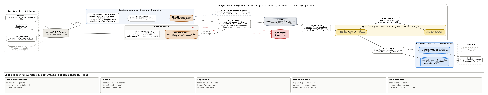

# Cloud Provider Analytics — Proyecto Integrador

**Minería de Datos II · ISTEA 2C 2026** · Prof. Diego Mosquera

## Equipo

| Integrante | GitHub |
|---|---|
| David Riveros | [@Davoo0o](https://github.com/Davoo0o) |
| Maria Lopez | [@MariaLopez1999](https://github.com/MariaLopez1999) |
| Ramon Ojea Espil | [@Reimonoo](https://github.com/Reimonoo) |
| Sebastián Gonzalez | [@SebGalvaleira](https://github.com/SebGalvaleira) |

Pipeline de datos para un proveedor de nube. Incluye ingesta batch y streaming, un Data Lake (Landing → Bronze → Silver → Gold) en Parquet y marts para FinOps servidos en Cassandra/AstraDB.

| Entrega | Contenido | Documento |
|---|---|---|
| **1 · Diseño** (07/10) | Problema, 5V, fuentes, arquitectura, Data Lake, MapReduce | [`docs/diseno_entrega1.md`](docs/diseno_entrega1.md) |
| **2 · Implementación** (18/11) | Pipeline ejecutable en PySpark con pruebas, serving en AstraDB y analítica | este README y [`docs/entrega2/`](docs/entrega2/) |

---

## Entrega 2 · Pipeline ejecutable



El diagrama v2 muestra **solo lo implementado**. Lo pendiente aparece en gris y figura en el [backlog](docs/entrega2/backlog_mvp.md).

### Resultados principales

| Capa | Resultado | Notebook |
|---|---|---|
| Bronze batch | 4 maestros: 80 orgs · 800 users · 400 resources · 240 facturas. `landing = bronze + inválidos + duplicados` en todas las tablas | `E2_01` |
| Bronze streaming | 120 micro-lotes → **43.200 eventos únicos** en 60 particiones por día. Recupera una falla a mitad de lote sin duplicar | `E2_02` |
| Silver | 43.200 eventos conformados: 2.075 unidades deducidas, 211 costos negativos marcados, 49 picos marcados. 5 reglas duras probadas con casos inyectados | `E2_03` |
| Gold | `org_daily_usage_by_service`: **11.050 filas · 147.433,98 USD**, idéntico al MapReduce de la entrega 1 | `E2_04` |
| Pruebas | 4 pruebas controladas OK: duplicado, evento tardío, micro-lote reprocesado y duplicado que llega a Silver | `E2_05` |
| Serving | AstraDB `finops`: 2 tablas query-first. Carga idempotente (11.050 → 11.050). Q1 en Astra = Gold | `E2_06` |
| Analítica | z robusto (MAD) por serie: encuentra los 49 picos de la regla y 33 picos relativos que la regla global no ve. `cost_anomaly_mart` con 289 filas | `E2_07` |

---

## Quickstart

Todo corre en **Google Colab** desde el navegador. No hace falta instalar nada en la PC.

### Requisitos
- Una cuenta de Google (Colab + Drive). El Data Lake ocupa unos 100 MB en `Mi unidad/cpa_datalake/`.
- Una cuenta de AstraDB, gratuita, **solo para `E2_06`**.

### Paso 1 · Preparar el Data Lake (una sola vez)
1. Abrir [`notebooks/e2/E2_00_setup.ipynb`](notebooks/e2/E2_00_setup.ipynb) con el botón **Open in Colab**.
2. *Entorno de ejecución → Ejecutar todas*. Autorizar el acceso a Drive cuando lo pida.
3. Resultado esperado: `Landing copiada a Drive` y `Spark 4.0.5 · filas en customers_orgs: 80`.

El notebook clona este repo y copia `data/datalake/landing/` a `Mi unidad/cpa_datalake/landing/`. Si Landing ya existe, **no la toca**, porque es inmutable.

### Paso 2 · Preparar AstraDB (una sola vez, solo para `E2_06`)
1. En [astra.datastax.com](https://astra.datastax.com), crear una base **Serverless (Non-Vector)** llamada `cloud_provider_analytics` con el keyspace **`finops`**.
2. En **Connection details**, generar un *Application Token* con rol **Database Administrator**.
3. En la misma pantalla, usar **Download SCB** y subir el zip a `Mi unidad/cpa_secrets/`, sin descomprimir.
4. En Colab, abrir el panel  **Secretos** (Secret) y crear `ASTRA_DB_TOKEN` con el token. Activar *Acceso desde el cuaderno* en `E2_06`.

> El token y el bundle **nunca** se suben al repo ni se escriben en un notebook.

### Paso 3 · Ejecutar el pipeline en orden

Para cada notebook: abrirlo en Colab, hacer *Entorno de ejecución → Reiniciar sesión*, luego *Ejecutar todas*, y verificar el resultado esperado.

| # | Notebook | Lee | Escribe | Resultado esperado |
|---|---|---|---|---|
| 01 | `E2_01_bronze_batch` | landing | `bronze/{customers_orgs, users, resources, billing_monthly}` | Tabla con `cuadra = True` en las 4 tablas; antes = después en la re-ejecución |
| 02 | `E2_02_bronze_streaming` | landing | `bronze/usage_events`, `checkpoints`, `stream_input` | `43.200 eventos, todos únicos, en 60 particiones por día` (la falla del lote 5 es **intencional**) |
| 03 | `E2_03_silver` | bronze | `silver/usage_events`, `silver/customers_orgs` | `silver 43200 · quarantine 0 · cuadra True`; los 4 casos inyectados van a quarantine con su motivo |
| 04 | `E2_04_gold` | silver | `gold/org_daily_usage_by_service` | `Spark reproduce exactamente el MapReduce de la entrega 1` |
| 05 | `E2_05_pruebas_controladas` | landing, bronze (maestros) | `pruebas/` (sandbox aislado) | `Prueba 1 OK` … `Prueba 4 OK` (el traceback de la prueba 3 es la falla simulada) |
| 06 | `E2_06_serving_astradb` | gold | AstraDB `finops` | `Recargar no duplica` y `Total 419.1986 USD = Gold ✓` |
| 07 | `E2_07_analitica_anomalias` | gold | `gold/cost_anomaly_mart` | `MAD z robusto > 5`: 82 marcados, 49/49 picos, 33 nuevas |
| 99 | `E2_99_exportar_evidencia` | todo el lake | `evidence_e2.zip` (descarga) | Inventario de rutas y tamaños, más muestras CSV |

### Reglas de ejecución
- **Un notebook a la vez, en orden.** Hay que esperar la línea `✓ sincronizado: ...` antes de abrir el siguiente. Si un notebook restaura de Drive mientras el anterior todavía sincroniza, lee datos incompletos. El assert de `E2_04` lo detecta.
- Cada notebook **trabaja en el disco local de Colab** (`/content/cpa_datalake`). Al empezar, restaura de Drive solo las carpetas que lee (`restaurar(...)`). Al terminar, sincroniza solo las que escribe (`guardar_en_drive(...)`).
- **Re-ejecutar es seguro.** Todos los pasos son idempotentes. La excepción es la celda de reinicio de `E2_02`: borra a propósito el Bronze de eventos y el checkpoint para repetir la simulación desde cero.

### Configuración

| Parámetro | Valor | Dónde |
|---|---|---|
| Data Lake persistente | `/content/drive/MyDrive/cpa_datalake` | celda de setup de cada notebook |
| Copia de trabajo | `/content/cpa_datalake` (disco local de Colab) | celda de setup |
| Spark | 4.0.5 · `session.timeZone = UTC` · `shuffle.partitions = 8` · `partitionOverwriteMode = dynamic` | celda de setup |
| Streaming | `trigger(availableNow)` · `maxFilesPerTrigger = 10` · watermark 1 h sobre `ingest_ts` | `E2_02` |
| Umbrales de calidad | costo mínimo −0,01 · pico > 5 × p99 (83,59 USD) | `logs/umbrales.json` (calculado en `E2_03`) |
| Umbral de anomalías | z robusto (MAD) > 5 · mínimo 14 días por serie | `E2_07` |
| AstraDB | token en el secret `ASTRA_DB_TOKEN` · bundle en `MyDrive/cpa_secrets/secure-connect-*.zip` · keyspace `finops` · `LOCAL_QUORUM` | `E2_06` |

### Manejo de errores conocidos

| Síntoma | Causa | Solución |
|---|---|---|
| `dataproc-spark-connect requires pyspark...` al instalar | Paquete preinstalado de Colab que no usamos | Ignorar el aviso |
| `JAVA_GATEWAY_EXITED` | `JAVA_HOME` apunta a un Java inexistente, o se instaló PySpark 3.5 (no soporta Python 3.13) | Usar el setup estándar (`pyspark>=4.0,<4.1` y `os.environ.pop('JAVA_HOME')`) y reiniciar la sesión |
| Parquet de 0 bytes / `is not a Parquet file` | Se escribió directo en Drive, que tiene consistencia eventual | Trabajar en disco local y sincronizar con `guardar_en_drive` (ya es el diseño) |
| Assert de `E2_04` falla con menos días | Se abrió `E2_04` antes de que `E2_03` terminara de sincronizar | `!rm -rf /content/cpa_datalake`, reiniciar la sesión y volver a correr |
| La restauración tarda varios minutos | Bronze de eventos tiene muchos archivos chicos | Esperar. Cada notebook ya restaura solo lo que necesita |
| `SecretNotFoundError` / `NotebookAccessError` | Falta el secret o el acceso del notebook | Panel  → crear `ASTRA_DB_TOKEN` y activar el acceso para ese notebook |
| `StopIteration` en la celda de conexión de `E2_06` | El bundle no está en `MyDrive/cpa_secrets/` | Subir el zip a esa carpeta |
| `NoHostAvailable` / timeout en AstraDB | La base gratuita se hiberna si no se usa | Entrar a Astra y reanudar la base (*Resume*) |
| Warnings `USE <keyspace> with prepared statements` y `Aggregation query used without partition key` | Avisos del servidor: el segundo es el `COUNT(*)` que se usa **solo para validar** | No afectan el resultado |

### Pruebas y validaciones

| Qué se prueba | Cómo | Dónde |
|---|---|---|
| Conciliación sin pérdida | `landing = bronze + inválidos + duplicados` y `bronze = silver + quarantine + duplicados` | `E2_01`, `E2_03` |
| Idempotencia batch | Conteos antes = después al re-ejecutar la ingesta | `E2_01` |
| Recuperación del stream | Falla simulada en el lote 5; se reinicia con el mismo checkpoint: `nuevos 0 · ya_existian 3600` | `E2_02` |
| Reglas de calidad | 7 casos inyectados: 4 van a quarantine (sin id, value texto, org inexistente, versión 9), 2 se marcan (costo negativo, pico) y 1 duplicado se fusiona | `E2_03` |
| Exactitud de Gold | Igual al MapReduce manual de la entrega 1 (claves, costo y eventos) | `E2_04` |
| Idempotencia de Gold | Recálculo total y parcial (2 fechas) sin cambios | `E2_04` |
| Duplicado · tardío · fallo · duplicado en Silver | 4 pruebas de punta a punta con asserts | `E2_05` |
| Serving | Carga repetida sin duplicar; Q1 y Q2 en Astra = Gold; consulta fuera de diseño rechazada | `E2_06` |
| Umbral de anomalías | Sensibilidad 3,5 / 5 / 7 / 10 contra los picos de la regla | `E2_07` |

### Evidencia
En [`evidence/e2/`](evidence/e2/):
- **`logs/`**: log por corrida (`ingesta_batch.jsonl`), log por micro-lote (`stream_bronze.jsonl`), conteos de Silver, `umbrales.json`, `pruebas_controladas.json`, carga y consultas de Astra, y comparación de métodos de anomalías.
- **`inventario_lake.csv`**: rutas, cantidad de archivos y tamaño por zona y tabla.
- **`muestras/`**: muestras CSV de Silver, Gold, `cost_anomaly_mart` y quarantine.
- **`capturas/`**: Q1, Q2, la consulta rechazada y el esquema en el CQL Console de Astra.

### Documentación de la entrega 2

| Documento | Contenido |
|---|---|
| [`docs/entrega2/plan_correcciones.md`](docs/entrega2/plan_correcciones.md) | Feedback de la entrega 1, correcciones aplicadas y desvíos respecto del diseño |
| [`DECISIONS.md`](DECISIONS.md) | Log de decisiones: patrón, particiones, claves Cassandra, umbrales |
| [`docs/entrega2/modelo_cassandra.md`](docs/entrega2/modelo_cassandra.md) | Matriz consulta-tabla: partition key, clustering, tamaño, replicación y consistencia |
| [`docs/entrega2/gobierno.md`](docs/entrega2/gobierno.md) | Controles, metadatos, linaje, responsabilidades y acceso |
| [`docs/entrega2/backlog_mvp.md`](docs/entrega2/backlog_mvp.md) | Trabajo restante: obligatorio, deseable y fuera de alcance |
| [`cql/`](cql/) | Scripts CQL: esquema y consultas |

---

## Entrega 1 · Diseño y fundación de datos

 **Documento principal:** [`docs/diseno_entrega1.md`](docs/diseno_entrega1.md) · Diagrama: [`docs/img/arquitectura_v1.png`](docs/img/arquitectura_v1.png)

| # | Punto | Sección |
|---|---|---|
| 1 | Problema, usuarios y objetivos medibles | §1 |
| 2 | Justificación Big Data (5V) | §2 |
| 3 | Inventario y perfil de fuentes | §3 |
| 4 | Arquitectura de alto nivel | §4 |
| 5 | Patrón (híbrido) | §5 |
| 6 | Matriz requisito → componente | §6 |
| 7 | Diseño del Data Lake | §7 |
| 8 | Flujos batch y streaming | §8 |
| 9 | MapReduce | §9 |
| 10 | Supuestos, riesgos y decisiones abiertas | §10 |
| 11 | Esfuerzo, roles y recursos | §11 |

**Hallazgo principal:** cada uno de los 120 micro-lotes trae datos de los **60 días** del período. Un watermark típico de 2 h descartaría el **99 %** de los eventos (`notebooks/04`). Por eso el streaming **no agrega por ventanas**: guarda todo y recalcula solo las fechas que cada lote modifica. La entrega 2 lo implementa así.

| Notebook (exploración, pandas) | Qué demuestra |
|---|---|
| `01_mirar_los_datos.ipynb` | Archivos, filas, grano, esquema v1/v2 |
| `02_perfil_de_calidad.ipynb` | Problemas de calidad, desorden de micro-lotes, integridad referencial |
| `03_cifras_5v.ipynb` | Volumen proyectado, concentración del costo, KPIs de soporte |
| `04_arquitectura_watermark.ipynb` | % de eventos descartados según el margen del watermark |
| `05_mapreduce.ipynb` | MapReduce manual de `org_daily_usage_by_service` |

Para reproducirlos en local: `pip install -r requirements.txt` y luego `jupyter lab`. Para regenerar los diagramas: instalar Graphviz y correr `python docs/build_diagrama.py` (v1) o `python docs/build_diagrama_v2.py` (v2).

## Estructura

```
README.md · DECISIONS.md · requirements.txt
cql/                      esquema y consultas de AstraDB
data/datalake/landing/    dataset original (inmutable)
docs/
  diseno_entrega1.md      diseño (entrega 1)
  entrega2/               plan de correcciones, Cassandra, gobierno, backlog
  arquitectura_v1.dot · arquitectura_v2.dot · build_diagrama*.py
  img/                    diagramas exportados
  apuntes/                guías de estudio y defensa
notebooks/
  01–05                   exploración (entrega 1, pandas)
  e2/E2_00–E2_07, E2_99   pipeline (entrega 2, PySpark en Colab)
evidence/                 evidencia de la entrega 1
evidence/e2/              evidencia de la entrega 2
```

## Convenciones

- **Landing es inmutable:** los archivos originales no se modifican.
- **Nunca se borra un dato en silencio:** lo inválido va a quarantine con su `motivo`; lo sospechoso se marca con un flag.
- **Linaje desde Bronze:** `source_file`, `ingest_ts`, `batch_id` (batch) o `stream_batch_id` (streaming).
- **Nombres:** `snake_case`; los marts se nombran por su grano (`org_daily_usage_by_service`).
- **Fechas** en UTC; **montos** en USD.
- **Secretos fuera del repo:** token en Colab Secrets, bundle en Drive.
